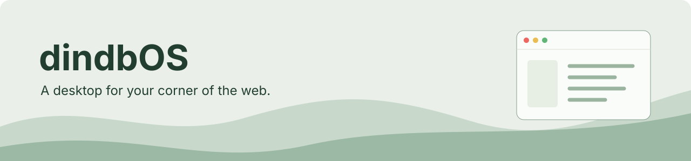
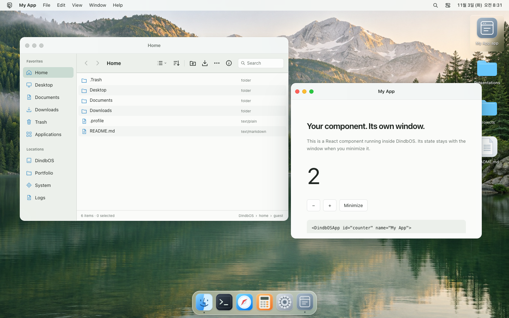

<p align="center"></p>

<h1 align="center">dindbOS</h1>
<p align="center">웹페이지에 데스크톱을 넣고, 내 앱을 올리세요.</p>
<p align="center"><a href="README.md">English</a> · <strong>한국어</strong></p>
<p align="center"><a href="https://dindb-dong.github.io/dindbos/">데모</a> · <a href="INSTALL.md">설치</a> · <a href="docs/react-apps.md">앱 만들기</a> · <a href="docs/customization.md">커스터마이징</a></p>

<p align="center"></p>

포트폴리오, 인터랙티브 프로젝트, 웹사이트의 일부 페이지를 macOS풍 데스크톱으로 만드는 SDK입니다. React 컴포넌트나 JavaScript 함수를 앱으로 등록하고, 테마와 데스크톱 UI를 바꿀 수 있습니다. 창·포커스·파일·실행 상태는 런타임이 관리합니다.

[개인 포트폴리오](https://dindb-dong.github.io/)에서도 실제로 사용합니다. Files·Notes·Reminders·Calendar·Photos·Music·Clock·TextEdit·Viewer·Terminal·Calculator·Activity Monitor·Settings를 선택해서 사용할 수 있습니다. [기본 앱 기능과 저장 위치](docs/builtin-apps.md).

> 이 문서는 현재 소스의 API를 설명합니다. 해당 소스가 npm에 게시되기 전에는 [INSTALL.md](INSTALL.md)의 로컬 tarball 설치를 사용하세요. 공개 데모는 이전 릴리스일 수 있습니다.

## 시작하기

현재 소스와 대응하는 npm 패키지가 게시된 경우:

```sh
npm exec --package=dindbos -- create-dindbos my-desktop --template react --yes
cd my-desktop
npm install
npm run dev
```

JavaScript 프로젝트는 `--template vanilla`로 생성합니다. CLI는 `dindbos` 패키지 안에 포함됩니다. 기존 파일을 기본적으로 덮어쓰지 않고, 의존성도 자동 설치하지 않습니다.

## React 앱 추가

```jsx
import React, { useState } from "react";
import { DindbOSDesktop, DindbOSApp } from "dindbos/react";
import "dindbos/styles.css";

function Hello() {
  const [count, setCount] = useState(0);
  return <button onClick={() => setCount(count + 1)}>클릭 {count}회</button>;
}

export default function DesktopPage() {
  return <DindbOSDesktop
    style={{ height: 640 }}
    storage={{ name: "my-desktop" }}
    theme={{ mode: "system", accent: "#287a58", wallpaper: "meadow", dockSize: 52 }}
    builtins={{ includePortfolio: false }}
    launch={["hello"]}
  >
    <DindbOSApp id="hello" name="Hello" icon="app" pinned desktop>
      <Hello />
    </DindbOSApp>
  </DindbOSDesktop>;
}
```

Hello가 창으로 열리고 데스크톱과 Dock에 아이콘이 생깁니다. 최소화·복원 시 상태가 유지되고, 닫은 뒤 다시 열면 새 인스턴스가 됩니다. 호스트의 React Context는 앱 안에서도 유지됩니다. 컨테이너 높이를 지정하고, 독립적인 데스크톱에는 서로 다른 storage name을 사용하세요.

기존 JavaScript `createAndBootDindbOS`와 `render({ content, os, window, context })` 방식도 유지합니다. 함수·클래스 앱은 `defineApp`으로 정의합니다. [첫 앱](docs/first-app.md) · [React 수명주기](docs/react-apps.md).

## 바꿀 수 있는 것

| 대상 | 방법 |
| --- | --- |
| 밝기·배경·강조색·Dock 크기 | `theme`, 런타임의 `setAppearance()` |
| 앱 내용과 아이콘 | React 컴포넌트·함수·클래스 앱 |
| 메뉴바·Dock·데스크톱·창 장식 | `ui.slots` 렌더러 |
| 기본 앱 구성 | include/exclude 후 사용자 앱 등록 |
| 초기 파일·저장소·실행 앱 | 호스트 설정 |

실행·권한·파일·창 상태의 소유권은 런타임에 둡니다. 신뢰된 호스트 앱과 설치형 패키지 앱의 권한 경계를 합치지 않습니다. [커스터마이징](docs/customization.md).

## CLI와 에이전트

```sh
npm exec --package=dindbos -- create-dindbos studio --template react --yes --json
npm exec --package=dindbos -- create-dindbos add app notes --root studio --json
npm exec --package=dindbos -- create-dindbos doctor studio --json
```

`--dry-run`은 파일을 쓰지 않고 결과를 보여줍니다. `--force`가 있어야 덮어쓰기를 허용합니다. 생성된 `src/apps/index.js`의 등록 마커가 없으면 앱 추가를 중단합니다. doctor는 로컬 프로젝트 구조를 확인하며 배포나 외부 서비스 정상 동작까지 증명하지 않습니다.

에이전트에게 전달할 요청:

> SOURCE에서 dindbOS를 설치해줘. INSTALL.md와 docs/agent-guide.md를 읽고 기존 파일과 라우트를 보존해. 컨테이너 하나에 데스크톱을 넣고 DindbOSApp으로 React 앱을 추가해. 공개 API로 테마를 바꾸고, 패키지 출처·빌드·앱 실행·키보드·정리를 확인해. 확인한 항목을 보고하고 게시·배포·push는 하지 마.

SOURCE를 저장소 또는 빌드한 tarball 경로로 바꾸세요. 생성 프로젝트에는 `AGENTS.md`가 포함됩니다.

## 예제와 지원 범위

[React/Vite](examples/react-vite), [Vanilla/Vite](examples/vanilla-vite), [Next.js](examples/next-client), [Astro](examples/astro-island) 예제가 있습니다. [배포 안내](docs/deployment.md)도 참고하세요.

브라우저 저장소는 권한·용량·삭제 정책에 영향을 받습니다. 중요한 파일은 내보내세요. 클립보드·로컬 폴더 기능은 브라우저 지원과 권한에 따라 달라집니다. Browser.app의 외부 사이트 탐색은 선택적인 [browser companion](docs/browserd.md)이 필요할 수 있습니다. 기본 데스크톱은 companion이나 Service Worker 없이 실행됩니다.

## 개발·기여

```sh
npm ci
npm run dev
npm run check
npm run build:sdk
npm run build
```

변경 영역의 smoke 검사를 실행하고 실제 화면과 동작을 확인하세요. [기여 안내](CONTRIBUTING.md) · [개발자 문서](docs/developer-guide.md).

## 라이선스

[MIT](LICENSE). 아이콘·SVG는 프로젝트의 원본 아트워크이며 데모 배경은 이 프로젝트를 위해 생성했습니다. [아트워크 출처](docs/assets/README.md)를 참고하세요. 연결된 외부 자료와 프로젝트에는 각각의 라이선스가 적용됩니다.
