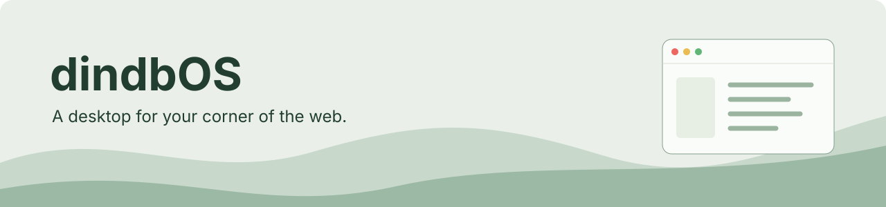
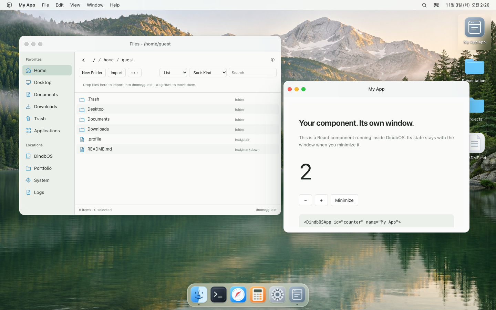

<p align="center"></p>

<h1 align="center">dindbOS</h1>
<p align="center">Give a page its own desktop. Bring your own apps.</p>
<p align="center"><a href="https://github.com/Dindb-dong/dindbos/blob/main/LICENSE">MIT</a> · React + JavaScript · Browser storage · Custom UI</p>
<p align="center"><strong>English</strong> · <a href="README-ko.md">한국어</a></p>
<p align="center"><a href="https://dindb-dong.github.io/dindbos/">Live desktop</a> · <a href="#quick-start">Quick start</a> · <a href="docs/react-apps.md">Write an app</a> · <a href="docs/customization.md">Customize</a> · <a href="docs/agent-guide.md">For agents</a></p>

<p align="center"></p>

[Watch the actual desktop in motion](docs/assets/demo.webm) · [Dark appearance](docs/assets/desktop-dark.png) · [Mobile](docs/assets/mobile.png) · [Two embedded desktops](examples/embedded/README.md)

A macOS-inspired desktop SDK for portfolios, interactive projects, and pages that deserve a different shape. Mount a desktop in one part of your site, register your components as apps, and replace its appearance without rewriting the runtime.

| You build | dindbOS handles |
| --- | --- |
| React components or JavaScript apps | App registration, windows, focus, and Dock state |
| Your theme, wallpaper, icons, and desktop UI | Shared state and documented UI replacement hooks |
| Documents and app content | Virtual files, browser-backed storage, and file associations |
| An embedded page or full-screen experience | Container-based layout and runtime cleanup |

The [portfolio](https://dindb-dong.github.io/) is a real SDK consumer. Built-in Files, TextEdit, Viewer, Terminal, Calculator, and Settings give a new desktop something useful to do.

> This README describes the current source revision. The new APIs need its corresponding package build; until that revision is published, use the local tarball instructions in [INSTALL.md](INSTALL.md). The hosted demo may still show an earlier release.

## Quick start

### Start a project

For a matching published package:

```sh
npm exec --package=dindbos -- create-dindbos my-desktop --template react --yes
cd my-desktop
npm install
npm run dev
```

Choose `--template vanilla` for a JavaScript host. The CLI lives inside the `dindbos` package; a separate `create-dindbos` package is not required. It preserves existing files by default and does not install dependencies automatically.

[Build and install from source](INSTALL.md) · [CLI options](#cli)

### Put a desktop in your app

```sh
npm install dindbos
```

```jsx
import React, { useState } from "react";
import { DindbOSDesktop, DindbOSApp } from "dindbos/react";
import "dindbos/styles.css";

function Hello() {
  const [count, setCount] = useState(0);
  return <button onClick={() => setCount(count + 1)}>Clicked {count} times</button>;
}

export default function DesktopPage() {
  return (
    <DindbOSDesktop
      style={{ height: 640 }}
      storage={{ name: "my-desktop" }}
      theme={{ mode: "system", accent: "#287a58", wallpaper: "meadow", dockSize: 52 }}
      builtins={{ includePortfolio: false }}
      launch={["hello"]}
    >
      <DindbOSApp id="hello" name="Hello" icon="app" pinned desktop>
        <Hello />
      </DindbOSApp>
    </DindbOSDesktop>
  );
}
```

**Expected result:** Hello opens in a window, its counter survives minimizing and restoring, and its launcher appears on the desktop and Dock. Closing unmounts the app; reopening starts a new instance. Host React context stays available inside the app.

Give the host a real height. Use a unique storage name for independent desktops. [React app lifecycle and context](docs/react-apps.md).

### Prefer JavaScript?

```js
import { createAndBootDindbOS, defineApp } from "dindbos";
import "dindbos/styles.css";

const hello = defineApp({
  id: "hello", name: "Hello", pinned: true, desktop: true,
  render({ content }) {
    const title = document.createElement("h1");
    title.textContent = "Hello from your site";
    content.replaceChildren(title);
  },
});

const desktop = createAndBootDindbOS({ root: "#desktop", apps: [hello], launch: ["hello"] });
// In your route cleanup, call: desktop.then((os) => os.destroy());
```

The existing imperative registration API remains available. Class instances work through `defineApp(new MyApp())`; instance methods are bound during normalization. [Function and class examples](docs/first-app.md).

## Make it yours

- **Appearance:** light/dark/system, wallpaper, accent, Dock size, CSS variables, and app icons.
- **Apps:** React content, imperative render functions, class instances, manifests, and file associations.
- **Desktop UI:** replace desktop, menu bar, Dock, or window chrome through `ui.slots`.
- **Built-ins:** select or exclude apps, then register your replacements.
- **Host integration:** keep your existing page, routing, React providers, and storage configuration.

The runtime continues to own execution, file permissions, and window state. Trusted host components and installed package apps keep their existing trust boundaries. [Customization guide](docs/customization.md).

## CLI

```sh
# Create without prompts; return a machine-readable result
npm exec --package=dindbos -- create-dindbos studio --template react --yes --json

# Add and register an app in a generated project
npm exec --package=dindbos -- create-dindbos add app notes --root studio --json

# Inspect the generated host files without changing them
npm exec --package=dindbos -- create-dindbos doctor studio --json

# Preview creation without writing files
npm exec --package=dindbos -- create-dindbos studio --template vanilla --dry-run --json
```

`--force` explicitly permits overwriting target files. `add app` uses the registry markers in generated `src/apps/index.js`; if they are missing, it stops before writing. Doctor checks local project structure, not deployed behavior or remote services.

## Have an agent build with it

> Install dindbOS from SOURCE into this project. Read INSTALL.md and docs/agent-guide.md. Preserve existing files and routes. Mount one desktop in a named container, add a React app using DindbOSApp, and customize the appearance through public APIs. Verify the package source, build, app launch, keyboard interaction, and cleanup. Report what you checked. Do not publish, deploy, or push.

Replace `SOURCE` with the repository or a built package tarball. Generated projects include their own `AGENTS.md`. [Agent installation guide](docs/agent-guide.md).

## Examples and browser boundaries

Examples cover [React/Vite](examples/react-vite), [Vanilla/Vite](examples/vanilla-vite), [Next.js client routes](examples/next-client), and [Astro islands](examples/astro-island). See [examples](examples/README.md) and [deployment](docs/deployment.md) and [troubleshooting](docs/troubleshooting.md).

Files use the browser's available storage. Persistence can be denied or evicted; export important files. Clipboard, local folders, and other browser features depend on browser support and permission. Browser.app can show local HTML; unrestricted external sites may require the optional [browser companion](docs/browserd.md). A normal desktop does not require that companion or a Service Worker.

Advanced runtime topics live in [the developer guide](docs/developer-guide.md), [app manifests](docs/app-manifest.md), [storage](docs/storage.md), and [package isolation](docs/isolation.md).

## Develop and contribute

```sh
npm ci
npm run dev
npm run check
npm run build:sdk
npm run build
```

Run the relevant smoke scripts for the area you change. The repository includes SDK, CLI, files, window-manager, and runtime checks; [CONTRIBUTING.md](CONTRIBUTING.md) explains the workflow. Keep screenshots and examples aligned with real behavior and preserve the public Vanilla API when adding React features.

## License

[MIT](LICENSE). Original dindbOS icons and SVG artwork are included. Demo wallpaper artwork was generated for this project; see [artwork provenance](docs/assets/README.md). Third-party projects and linked materials retain their own licenses.
